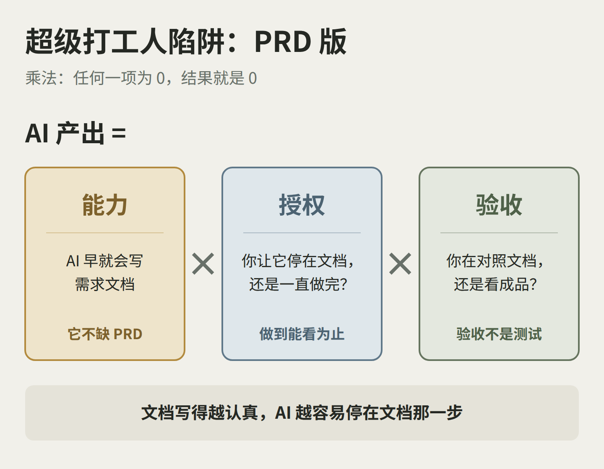
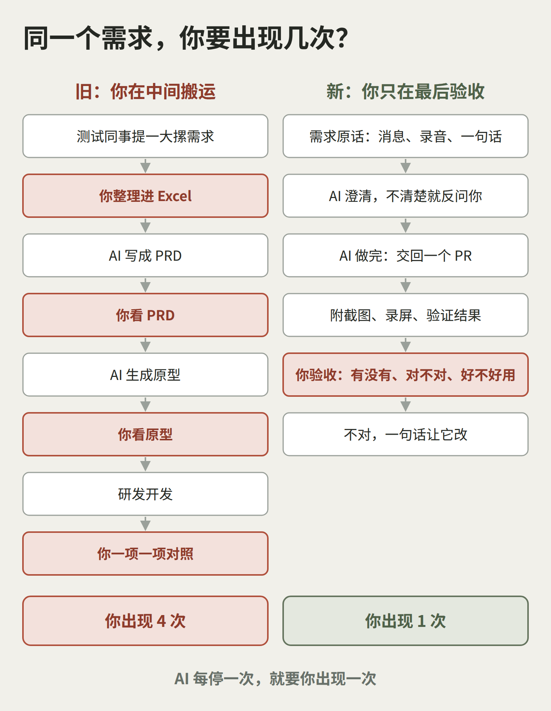
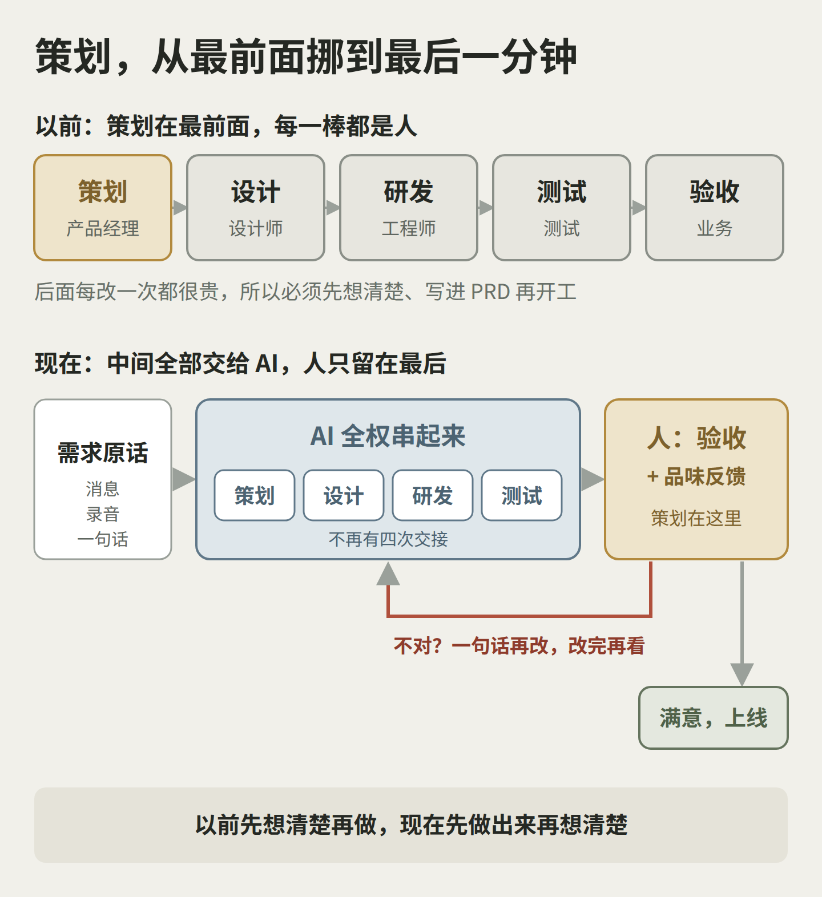
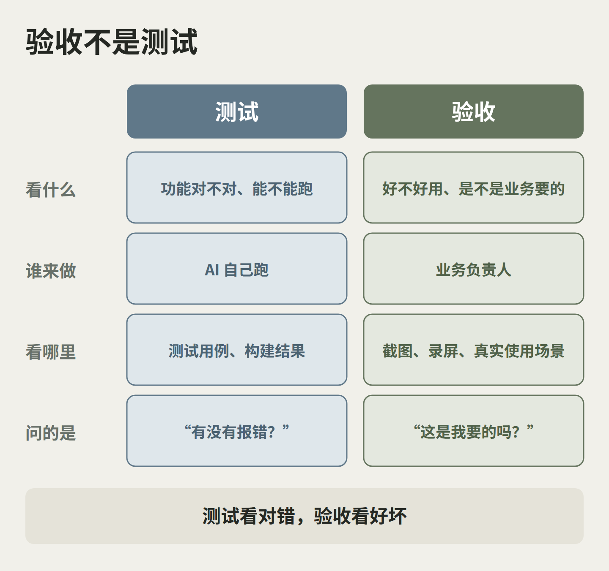
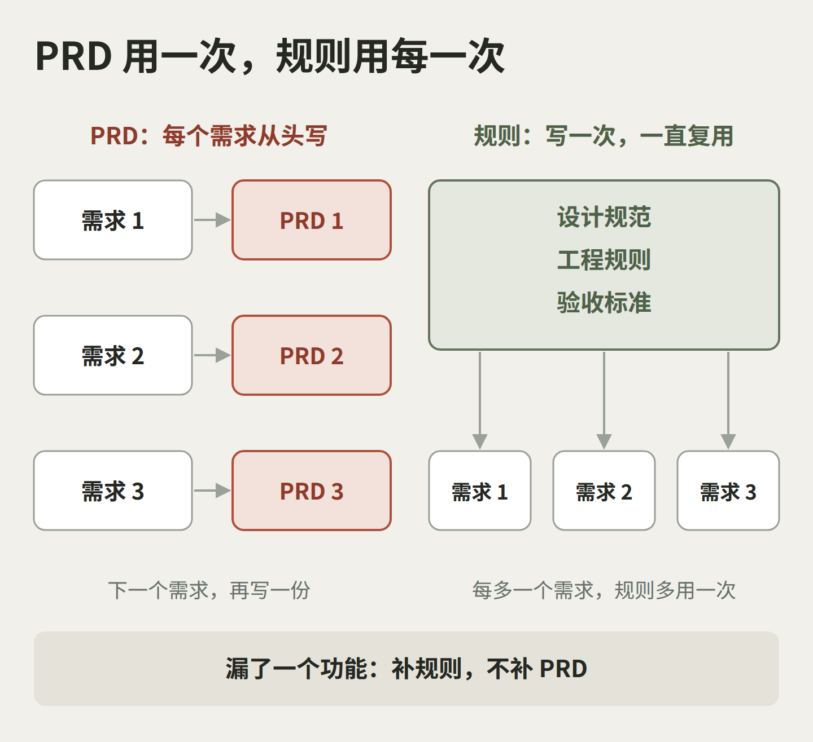
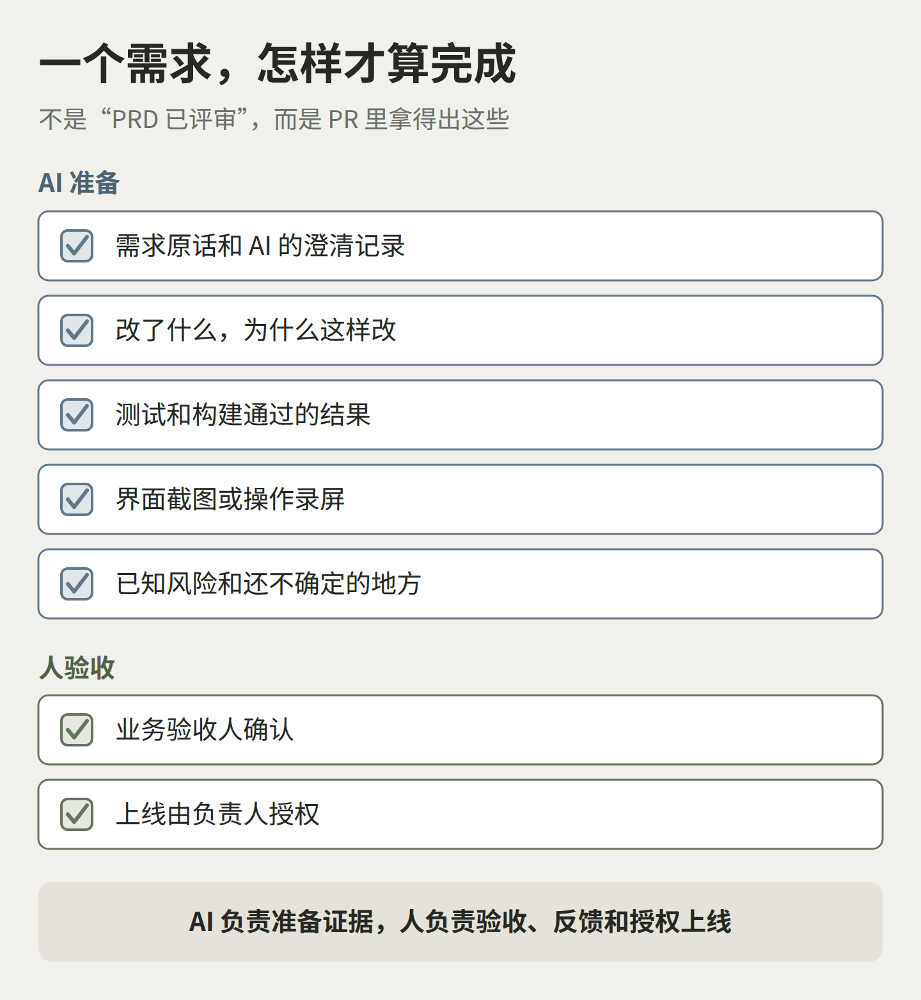

> **Kelly 陈霈霖**｜喜茶创始 CTO 兼董事会成员，维格 Vika / AITable 创始人，Buda AI 创始人。带过 150 人团队，主导 3 万人零售企业数字化转型；Vika 服务 100 万用户与 1.5 万家企业组织，获 IDG 资本、天图资本、五源资本、靖亚资本、高瓴创投投资，累计融资数千万美元。了解我：[个人简介](https://kellychan.im/resume/zh-cn/)｜[企业 AI 服务](https://kellychan.im/ai/)｜[CAIO Office](https://kellychan.im/ai/caio/)

最近在一个 AI 活动的会场，一位产品经理来找我聊。

TA 负责一款硬件配套的 App。测试同事经常提一大摞需求：要一键翻译，要能 @ 钉钉上的同事，要引用知识库，要创建工单。

TA 的做法很认真：把需求整理进 Excel，交给 AI 写成 PRD（产品需求文档，原本是产品经理写给设计、研发和测试看的需求说明），自己看一遍；再让 AI 生成原型，再看一遍。

结果呢？一键翻译，PRD 里写了，做出来没有；有了，位置不对；位置对了，不好用。需求一长，只能一项一项去对。

TA 说：“我好累呀。”

我说：“别写 PRD 了。现在还在写 PRD 的，都是小可爱。”

这句“小可爱”，不是笑 TA。TA 比大多数人都认真，只是认真用错了地方。

我把这种状态叫作：**超级打工人陷阱。**

> **AI 产出 = 能力 × 授权 × 验收**

所以，很多产品经理不是 PRD 写得不够细。恰恰相反：PRD 写得越认真，AI 越是停在文档那一步，你也越是那个在需求、文档和原型之间来回搬运的人。

这是乘法。AI 的能力早就够了；你只授权它写文档，它就只交文档；你手里没有可以对照的成品，就只能一行一行对。

说得再直接一点：**根本不需要产品经理去写 PRD。**

## “需求和 PRD，不是一个东西吗？”

聊到这里，TA 有点不服气。

“需求跟 PRD 不就是一个东西吗？”

不是。

“那 PRD 不就是文档吗？”

我给 TA 看的不是文档，是做完的东西。一个需求进来，AI 先澄清，澄清完直接做，交回来的是一个 PR（pull request，一次等人批准合并的代码改动，附带说明和证据）：问题是什么、改了什么、验证了什么，再加上产品界面的截图和录屏。

TA 看了一会儿，说：“我感觉跟我的也没什么差别啊。”

差别很大。

在 TA 的流程里，AI 每走一步就停下来，等人看。TA 看 PRD、看原型、看研发的结果、再对一遍需求，每一站都是 TA 在对照。TA 是整条流水线里最忙的人，也成了最慢的那一环。

一个人把自己活成了中转站，还以为自己在用 AI 提效。

## PRD 到底是写给谁的？

PRD 从来不是产品经理写给自己的。

它是一份翻译件。业务的人说得出要什么，但不懂技术；技术的人写得出代码，但不懂业务。两边说的不是同一种语言，中间就需要一个人，把业务的话翻译成技术看得懂的文档。这个人是产品经理，这份文档就是 PRD。

以前的流程又是一场接力赛：产品经理先做策划、写 PRD，设计师出设计稿，研发写代码，测试来测，最后业务验收。每一棒都换一拨人，每换一次，都要靠这份翻译件，信息才不会走样。

策划之所以放在最前面，是因为后面每一棒都很贵。设计改一次要几天，研发返工要几周。所以必须先想清楚、写清楚，再开工。

现在呢？AI 既听得懂业务的大白话，也看得懂代码。两边的语言它都懂，翻译件就没有存在的必要了。

> **PRD 是翻译件。两种语言 AI 都懂了，翻译件就该退场。**

说到底，PRD 是人与人协作的年代留下来的。到了人和 AI 协作，它的使命已经结束。

## 现在：策划挪到最后一分钟

现在，中间这些环节可以全部砍掉。

策划、设计、研发、测试，不再是四拨人四次交接，而是交给 AI 一次串起来。需求原话进来，AI 自己补齐策划：有哪些模块、哪些页面、怎么交互；再按设计规范出界面，写代码，跑测试，最后交回一个能看、能用的东西。

人只留在最后一步：验收和品味。

你看着做出来的东西，不停地给反馈：“这个按钮离得太远了”“翻译结果要能一键复制”“这个流程客户会看不懂”。每一句反馈，AI 很快改完，再交给你看。一轮一轮，直到你觉得对了，再授权上线。

这就是我说的：**策划没有消失，它从最前面挪到了最后一分钟。**

以前，策划是产品经理工作的前置，必须先想清楚才能开工。现在，做出一版的成本已经低到可以先做出来，你的策划变成了对着成品的一轮轮判断。

> **以前先想清楚再做，现在先做出来再想清楚。**

如果非说 PRD 还剩下点什么，那就是 AI 做完之后自动留下的记录：做了什么、怎么验证的，附在 PR 里留档。没有任何人需要去写它。

## AI 为什么总是漏功能？

回到 TA 的问题：PRD 里明明写了一键翻译，为什么做出来没有？

按式子拆，三个因子各有一个答案。

**能力：AI 不缺 PRD。** 大模型读过的需求文档，比任何一个产品经理一辈子写的都多。你可以试一下，只问它一句：“客服系统应该有哪些功能模块？”它会列出模块、每个模块的页面和交互，连测试点都能想到。你花一下午写的 PRD，有很多部分它本来就知道。

**授权：你只让它写，它就只写。** AI 停在文档，就没有东西可以被检查，你只能拿文档去对文档。让它一直做到能看的东西，漏没漏，一张截图就看出来了。

但授权不是放任。AI 敢一路做下去，前提是规矩已经写好了：品牌和设计规范规定界面长什么样，工程规则规定代码怎么写、怎么测试、怎么启动，验收标准规定什么算完成。这些放在代码仓库里，AI 每次开工都会先读。

还要把代码本身变成 AI 能理解的知识：有哪些产品、哪些仓库、哪些版本、文档放在哪里。我最近陪一个研发团队做转型，第一步做的就是这个，而不是教大家怎么写 PRD。

**验收：验收不是测试。** 测试看功能对不对、能不能跑，这部分 AI 可以自己做。验收看的是好不好用、是不是业务真正要的，这是人的品味和判断。验收也不是最后签个字，而是在最后这一环不停地给反馈，直到做对为止。

TA 又问：“那不就是我看哪里不对，再让它改？”

对，就是这样。区别在于，你对照的不再是一份几十页的文档，而是一个已经做出来的东西。

## 领导说“PRD 是写给 AI 看的”，对吗？

TA 说，领导一直强调：一定要让 AI 写个 PRD，这个 PRD 是给 AI 看的。

这句话只对了一半。AI 不需要你翻译，它需要的是上下文。但上下文不该是每个需求都重写一遍的 PRD，而是写一次、以后每次都能用的规则。

一份 PRD 只服务一个需求，下一个需求又从头写。一份设计规范、一份工程规则、一份验收标准，服务的是之后的每一个需求。

> **规矩写一次，每个需求都能用；PRD 写一次，只用一次。**

所以，AI 漏了一个功能，别回去把 PRD 写得更细。要问的是：这次漏掉，是哪一条规则没写？补上那一条，下次就不会再漏。

## 那产品经理还干什么？

这是 TA 最想问、又没好意思直接问的问题。

TA 讲了一个细节：问研发同事某个功能的触发条件，对方自己也不记得，转头去问 AI，然后截个图发过来：“对，就是这个。”TA 当时心里想：那我干嘛要问他？

这个细节说明，代码里的知识已经不在某个人的脑子里，而在 AI 读得到的地方。产品经理如果继续当需求的翻译和搬运工，位置只会越来越尴尬。

我们自己的团队，现在已经没有专职的产品经理。每周固定两次收集用户需求，录音直接交给 AI。我们花最多精力的地方是筛选：这个需求做还是不做，先做哪一个。

> **产品经理的价值，从写清楚，变成选对。**

写清楚，AI 已经比你快。选对，AI 还替不了你：哪个客户的需求值得做，哪个功能会伤到现有用户，哪个版本该先上线。这些判断，才是产品经理不可替代的那部分。

## 下一个需求，可以怎么试？

不用改造整个团队。下一个需求进来，换个做法跑一遍。

**第一步：不写 PRD，直接给原话。** 把需求的原始材料交给 AI：测试同事的消息、会议录音，或者你自己的一句话。让它先澄清，哪里不清楚就反过来问你。

**第二步：让它一直做到能看。** 不停在文档，也不停在原型，要它交回一个 PR：改了什么、怎么验证的、界面截图或录屏、还有哪里不确定。

**第三步：你只做验收和品味反馈。** 对照截图看三件事：有没有、在不在对的位置、好不好用。不对就一句话让它改，改完再看，直到你觉得对。

**第四步：漏了就补规则。** 每漏一次，就把原因写进设计规范或工程规则。坚持两周，你会发现需要你开口的次数越来越少。

一个需求怎样才算完成？不是“PRD 已评审”，而是 PR 里能拿出这样一份证据：

- 需求原话和 AI 的澄清记录；
- 改了什么，为什么这样改；
- 测试和构建通过的结果；
- 界面截图或操作录屏；
- 已知风险和还不确定的地方；
- 业务验收人确认，上线由负责人授权。

AI 负责澄清、实现、自测和准备证据；人负责取舍、验收和授权上线。

## 什么情况下，先别这样做？

策划挪到最后，不等于什么都不用先定。

涉及支付、合规、安全和用户数据的需求，仍然要有人事先拍板，不能让 AI 自己澄清完就直接做。规则还没写好的团队，也别第一天就全自动，先从一个低风险的需求开始。

我也不承诺固定的效率倍数。能快多少，取决于规则写到什么程度、验收跟不跟得上，而不是用了哪个模型。

我做过 CTO，带过 150 人的研发团队，很清楚 PRD 在人与人协作里起过的作用。正因为见过它的价值，我才更确定：到了人和 AI 协作，它该换个位置了。

> **别让 AI 停在文档，让它一直做到你能验收。**
>
> **验收不是测试：测试看对错，验收看好坏。**

下一个需求进来时，先别打开 PRD 模板，按上面四步跑一遍。如果还是漏，带着那次的需求原话和 AI 交回来的东西来找我，我们一起看缺的是哪一条规则。

延伸阅读：[研发里最稀缺的，不是写代码的人，是定规矩的人](https://kellychan.im/articles/ai-rd-rule-makers.html)
