> **Kelly 陈霈霖**｜喜茶创始 CTO 兼董事会成员，维格 Vika / AITable 创始人，Buda AI 创始人。带过 150 人团队，主导 3 万人零售企业数字化转型；Vika 服务 100 万用户与 1.5 万家企业组织，获 IDG 资本、天图资本、五源资本、靖亚资本、高瓴创投投资，累计融资数千万美元。了解我：[个人简介](https://kellychan.im/resume/zh-cn/)｜[企业 AI 服务](https://kellychan.im/ai/)｜[CAIO Office](https://kellychan.im/ai/caio/)

这篇整理自我 2026 年 10 月 18 日在 AI Agent Summit 香港的主题演讲：《Why Your Agents Won't Work》，你的 Agent 为什么不管用。

过去两年，我只干一件事：**在团队和企业里，把 Agent 真正落地。**

我相信你已经不需要我再讲“要不要做 AI”了。**这已经不是做不做的问题，而是怎么做的问题。** 这件事我磨了两年，换了好几种做法，也踩了不少坑。这篇文章，我把这些坑原原本本地摊开给你看。

## 只有一张图

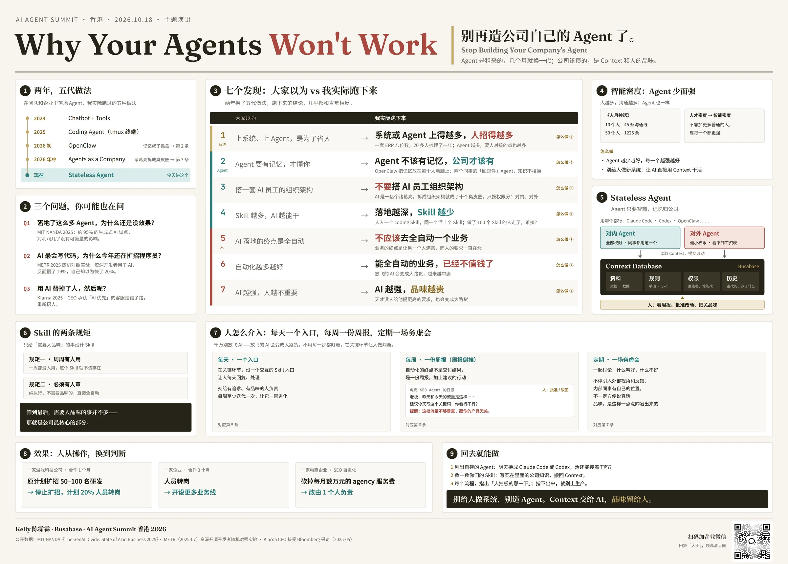

这篇文章，我只用一张图。

想要高清版，文末扫码就能拿。读完你会发现，今天说的每一句话，都在这张图上。

先教大家怎么看这张图。左上角，是我这两年换过的五代做法；左边下面，是三个大家常问的问题；中间最大的那张表，是今天的主角，七个发现；表的右边和下面，是每一条发现对应的“怎么做”；最下面一排，是效果，和回去就能做的三件事。

题目叫 **Why Your Agents Won't Work**，你的 Agent 为什么不管用。

副标题有点得罪人：**别再造公司自己的 Agent 了。**

为什么这么说？我们一块一块来看。

## 地图第 1 块：两年，五代做法

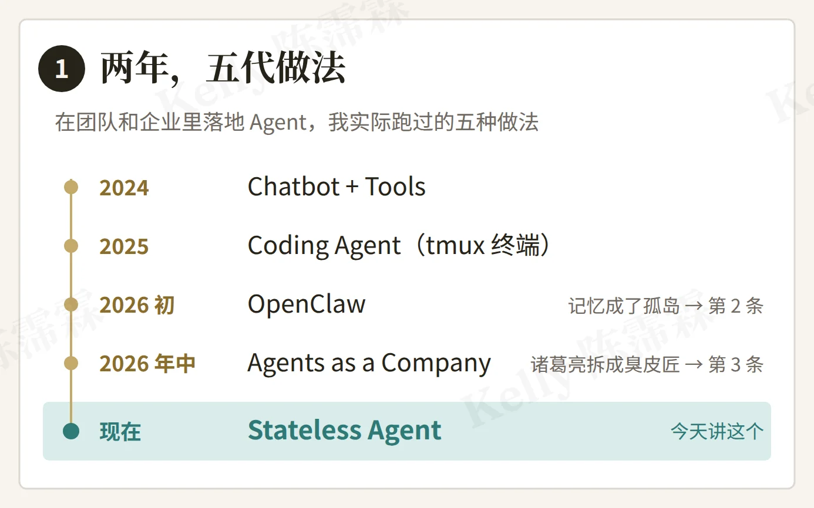

两年里，我换了五代做法。

2024 年，Chatbot 加 Tools，给聊天机器人接几个工具。

2025 年，Coding Agent，跑在 tmux 终端里。

2026 年初，OpenClaw。它让个人电脑，成了 Agent 的长期记忆。

2026 年年中，Agents as a Company：给 Agent 分岗位，搭一家 AI 公司。这一版是我自己做的，后来也是我自己推翻的。

现在，是 Stateless Agent，无状态的 Agent。今天就讲它。

每一代，我都在公司里真的跑过。所以下面讲的，不是我读来的，是我踩出来的。OpenClaw 和 Agents as a Company 这两代具体踩了什么坑，后面讲第二条、第三条的时候，我会讲给大家听。

## 地图第 2 块：三个问题

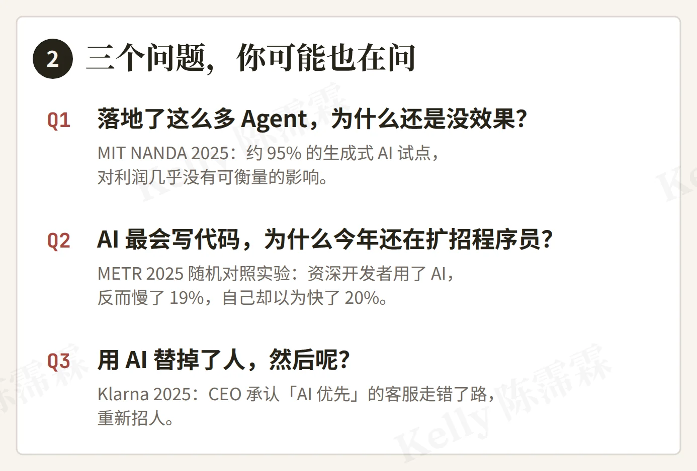

讲之前，我先问大家三个问题。

**第一个：落地了这么多 Agent，为什么还是没效果？**

不只是你这么觉得。去年 8 月，MIT 有个研究项目叫 NANDA，发了一份报告，叫《生成式 AI 鸿沟》。他们访谈了 150 位企业负责人，调查了 350 位员工，还分析了 300 个公开的 AI 项目。

结论是：只有大约 5% 的试点，真正带来了收入增长；剩下大约 95%，对利润几乎没有可衡量的影响。

为什么？报告的作者说，问题不在模型不够好，而在“**学习断层**”：通用的 AI 工具，不会去学、也不会去适应公司自己的流程。记住这个词。今天后面讲的 Context，就是在补这个断层。

**第二个：AI 不是最会写代码吗？为什么你们今年还在扩招程序员？**

有个研究机构叫 METR，专门做 AI 能力评测的。去年 7 月，他们做了一个随机对照实验：找了 16 位资深的开源开发者，在他们自己维护多年的项目里，做了 246 个真实的任务。每个任务随机决定，能不能用 AI。

结果，用了 AI 的任务，反而慢了 19%。最有意思的是：开始之前，他们以为 AI 能让自己快 24%；做完之后，他们还是觉得自己快了 20%。

当然，那是 2025 年初的工具，METR 后来也说，这个结果只能当历史看。我想说的不是 AI 写代码慢，而是：**感觉快了，和真的快了，是两回事。** 一个人觉得自己快了，不等于整个团队的产出多了。这也是为什么，很多公司一边用 AI 写代码，一边还在扩招。

**第三个：用 AI 替掉了人，然后呢？**

Klarna，瑞典那家“先买后付”的公司，前几年用 AI 替代客服，是最激进的公司之一。去年 5 月，它的 CEO 接受彭博采访时说，过去几年“AI 优先”的客服策略，是个失误：AI 比人便宜，但服务质量更差了。现在他们重新招人，承诺“只要你想，永远有真人可以找”。

这个故事，后面讲品味的时候，我们会再回来。

这三个问题，客户问过我，我也问过自己。

今天我的回答，是七个发现。

## 地图第 3 块：七个发现

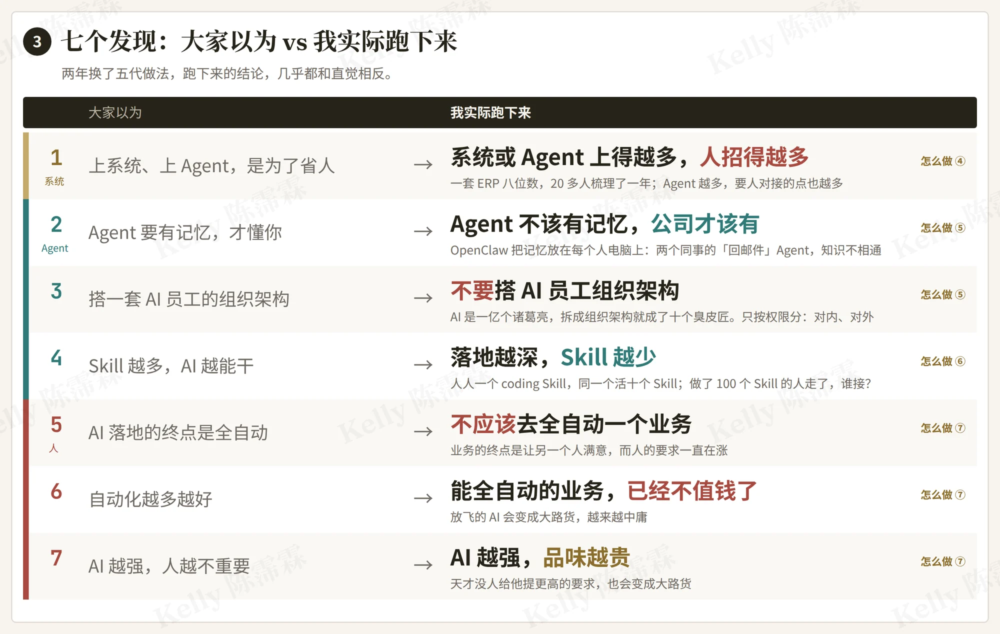

左边，是大家以为的。右边，是我实际跑下来的。

你会发现，右边几乎每一条，都和直觉反着来。

系统或 Agent 上得越多，人招得越多。

Agent 不该有记忆，公司才该有。

不要搭 AI 员工的组织架构。

落地越深，Skill 越少。

不应该去全自动一个业务。

能全自动的业务，已经不值钱了。

AI 越强，品味越贵。

这七条，分成三组。第一条讲系统；第二、三、四条讲 Agent 本身；第五、六、七条讲人。

每一行的最右边，还有一个小小的“怎么做”，指向地图上的另一块。也就是说，每一条发现，后面都有一个解法，不是光吐槽。

下面我一条一条讲，每一条后面，都有一个真实的故事。

## 第 1 条：系统或 Agent 上得越多，人招得越多

先讲我自己的一个故事。

在我的前公司，我们上过 ERP。

系统本身，八位数，人民币。

为了把它落地，我们找了二十多个人，占了一整间办公室梳理业务，梳理了一年。

上线以后，各个业务部门还要去招更懂系统、也更贵的人。

算下来，系统之外，差不多又花了一倍。

我不是说这笔钱白花了。它对公司后来的发展，是有帮助的。

但是你会发现：**它没有省钱。**

为什么？我们做一个软件，会很努力地去挖需求、去抠各种细节。但做出来的软件，最终是给人用的，**而人依然是瓶颈。** 系统做得越完善，越需要更强的人去用它。

那 Agent 呢？

今年年初，很多人觉得，Agent 越多，公司的 AI 就越厉害。我觉得，这是今年最大的一个误区。

我看到的正好反过来：**Agent 越多，交互点越多；交互点越多，就需要越多的人去跟它们打交道。** 每多一个 Agent，就多一个需要人去对接的地方。

这就回答了开场的那个问题：为什么落地了这么多 Agent，公司还在扩招？因为你把 Agent，当成了又一个给人用的系统。

这其实是个老道理。软件行业有一本经典的书，叫《人月神话》。它说：一个已经延期的项目，往里加人，只会更延期。因为人越多，人和人之间要沟通的线就越多。两个人之间，一条线；十个人，四十五条线；五十个人，一千两百二十五条。

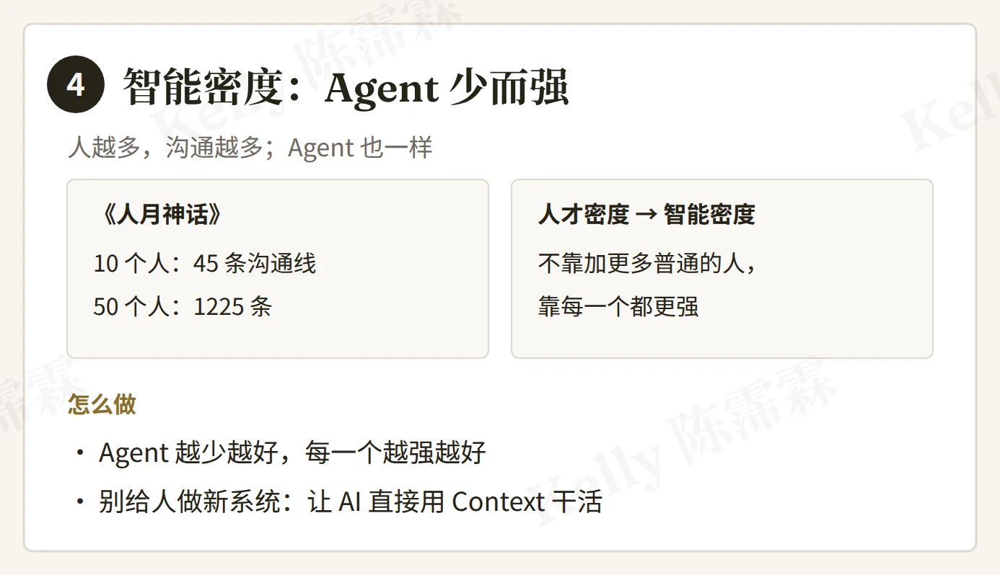

做公司的人都懂：人越多，沟通成本越高，效率越低。所以现在大家讲“人才密度”：与其往里加很多水平一般的人，不如提高每一个人的能力。

到了 Agent 这里，是一样的。**我把它叫做 Agent 的“智能密度”。**

不是 Agent 越多越好。是每一个 Agent 越强越好，数量越少越好。

所以怎么做？两件事。

第一，**Agent 越少越好，每一个越强越好。** 能用一个 Agent 干完的事，就别拆成十个。

第二，**别再给人做一套新系统了。** 让 AI 直接用公司的 Context 去干活，人只做判断。以前上一套系统，要先找一屋子人梳理一年，再招一批人来用它；现在 AI 可以做到不一样：让它直接读公司的资料、规则和历史，把活干了，人只看结果、做决定。

## 第 2 条：Agent 不该有记忆，公司才该有

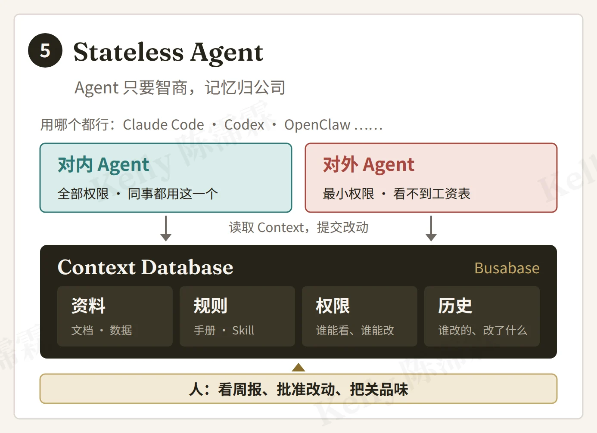

第二条，可能是今天最反直觉的一条。

现在大家都在给 Agent 加记忆。我说：**Agent 不该有记忆，公司才该有。**

今年的 OpenClaw 是个很大的突破。它真正让个人电脑，成了 Agent 的长期记忆。你一个人用，一台电脑，那是无敌的，你教过它的东西，它都记得。

但是一进公司，团队一协作，问题就来了。

每个 Agent 的记忆，都在各自那个人的电脑上。每一份记忆，都是一座孤岛。

举个例子。销售部的 A 和 B 两个同事，各自做了一个“客服回邮件”的 Agent。B 的那个越用越好，A 的那个一直跟不上。B 的 Agent 学会的东西，A 的 Agent 一点都拿不到，因为它们的记忆是隔开的，知识没办法共享。

最理想的是什么？A 和 B 用同一个 Agent。

偏偏是 Agent 自带的记忆，把它们隔开了。

所以我说，Agent 应该是无状态的。**它带着智商来就好。**

公司的东西，放在公司自己的一个地方，我叫它 Context Database。里面有四样东西：

资料，就是文档和数据；

规则，就是做事的手册和 Skill；

权限，谁能看什么、谁能改什么；

历史，谁改过什么、改了什么。

公司层面只有这一份共享的 Context，所有 Agent 都读它。Agent 本身不需要记忆，它们只负责执行。

我们要管的，是这一份公司的 Context，而不是去管每个 Agent 各自记了什么，那太费劲了。

这样做，有三个好处。第一，换 Agent 不丢东西：Claude Code 也好，Codex 也好，OpenClaw 也好，明年再换一批也没关系。第二，同事之间不再是孤岛：B 教会的，A 马上就能用上。第三，人走了，知识还留在公司。

做开发的朋友会觉得很眼熟。互联网架构早就学会了这件事：服务是无状态的，状态都在数据库里，所以服务可以随时换、随时扩。

**今天企业 AI 要学的是同一件事：Stateless Agent，加一个 Context Database。**

## 第 3 条：不要搭 AI 员工组织架构

第三条，我要先否定我自己。

今年年中，我做过一版 Agents as a Company：给 Agent 分岗位、搭组织架构，搭成一家 AI 公司。

几乎所有人落地 Agent，都会下意识地照搬人类已有的组织架构去分工。我也是。

但你想想，人类为什么要有组织架构？

因为一个人的能力是有限的，没办法全能，所以必须分工。三个臭皮匠，顶个诸葛亮。

AI 呢？AI 是全能的，而且可以无限复制。等于你手上有一亿个诸葛亮。

你再把它按组织架构拆开，是在干什么？**是把一亿个诸葛亮，拆成十个臭皮匠。**

我们实地落地下来，看到的就是这样：Agent 拆得越多，落地越差，公司的人反而越多。Agent 之间一来一回，诸葛亮的智慧就被一点点稀释掉，变成了臭皮匠。**是我们自己，把 AI 搞蠢了。**

那 Agent 到底该怎么分？

我的答案是：**只按权限分**，也就是它能碰什么数据。

最理想的状态，就两个 Agent。

一个对内。它有你所有的权限，是一个全能的 Agent，全公司的同事都用这一个。

一个对外。它要服务客户、服务别人，所以反而不能给它那么多权限，它不能泄密。对外的 Agent，总不能知道你公司的工资表吧？

所以一家公司最理想的，其实就是一个 Agent。我们今天看到的多个 Agent，很多时候只是因为权限不一样，而不是因为岗位不一样。

## 第 4 条：落地越深，Skill 越少

第四条，也是一个很大的误区。

每个人有了自己的 Agent，就每个人都想要一个自己的 Skill。比如，每个人都有一个自己的 coding skill。久而久之，公司里干同一个活，有十个 Skill。

这十个 Skill，没有一个是集了众人之力的。还是刚才那个道理：明明是诸葛亮，被硬生生拆成了十个各不相同的臭皮匠。

那 Skill 到底是什么？

我的定义是：**Skill 的本质，就是 SOP，加上知识和规范。**

那它为什么要单独存在？因为 **Skill 是人和 AI 交互的起点**。它存在的意义，是让人可以显式地去调用它。你可以把它想象成一个按钮：人想让 AI 按某种方式做一件事，就去按这个按钮。

所以 Skill 越多，闲置的 Skill 也越多。Skill 一多，每一个的使用者就越少。

再想一个场景：假如公司里有个天才，做了一百个 Skill，然后他离职了。这一百个 Skill，谁来接？每个人都有自己的一套，最后就是一堆没人维护的 Skill。

所以我说，**落地越深，Skill 越少。** 入口要少，知识要放回公司的知识库。不要让任何一个人的 Agent 自己去长，公司里的 Agent 都是无状态的，接的都是公司的数据库和知识库。**只有那一份，才是公司自己的资产。**

第三、第四条，我在《[团队落地 AI，为什么要先把 Agent 和 Skill 减下来？](/articles/why-teams-should-start-with-fewer-agents-and-skills.html)》里展开写过：怎样从一项真实任务出发，算出够用的配置。

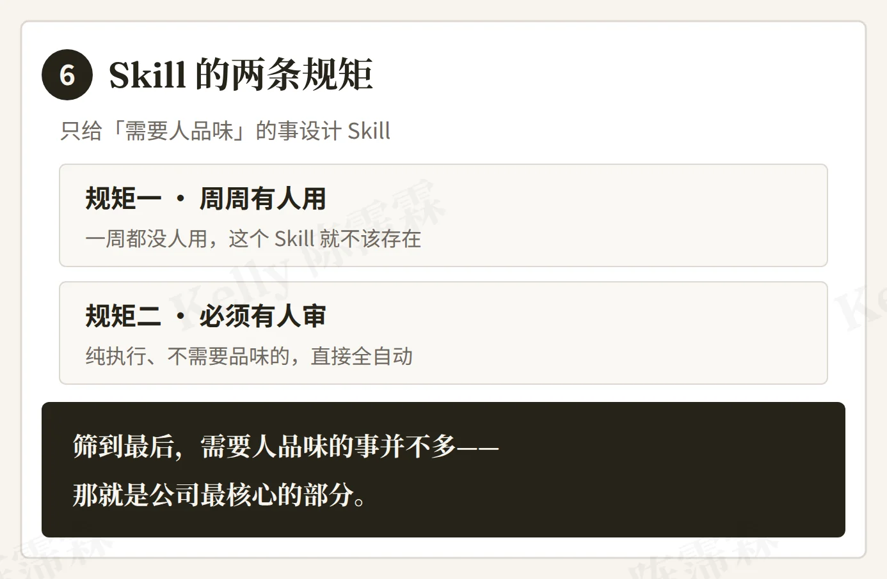

那 Skill 该怎么设计？

我的原则是：**Skill 围绕品味来设计。**先想清楚，哪些任务需要一个人去品味、去审核。只有这种事，才需要一个 Skill。

而且只要有一个 Skill，就必须满足两条规矩。

第一，**周周有人用**。这个 Skill 存在，就必须保证它每周都有人在用。一周都没人用，它就不需要存在。

第二，**必须有人品味、有人审**。如果只是纯执行，不需要品味，那就直接全自动，这件事就结束了。

所以你会发现，真正需要人去品味的东西，其实并不多。**筛到最后的，就是公司最核心的那部分。** 需要人每天去交互的事，并没有那么多。

Skill 变少，不等于不管了。留下来的、作为公司资产的那几个 Skill，要不断地更新。

这里，人的作用非常大。十个 Skill 怎么并成一个，谁的做法留下来，这是管理，也是品味。我非常强调人的品味，还有管理。

## 第 5、6、7 条：别放飞 AI

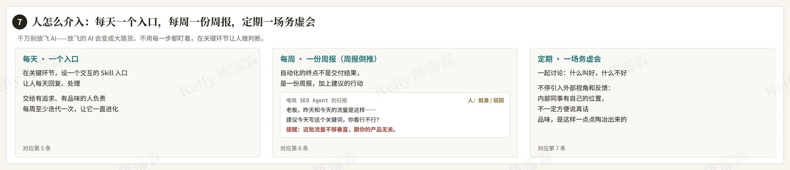

最后三条，我放在一起讲。

**第五条：不应该去全自动一个业务。**

我们做任何事情，最终目标都是服务另一个客户，让另一个人满意。而客户的要求，越来越高。

人需要不停地判断：另一个人的需求，又往上走了。**这个判断，就是品味。**

所以“全自动”，本质上是个伪命题。

当然，这不是说不要自动化。每个工作都可以自动化，但不代表每个流程，都还要人手进去操作。**我们要设计一套规范和系统，在关键的环节，让人进来做判断。**

**第六条：能全自动的业务，已经不值钱了。**

千万不要放飞 AI。放飞的 AI，会变成大路货，越来越中庸。

什么叫放飞？就是把事情交给 AI 以后，没人给它提要求，也没人看结果。

还记得开场的 Klarna 吗？AI 比人便宜，但服务质量差了，最后又把人请了回来。

**第七条：AI 越强，品味越贵。**

其实公司里一直是这样。哪怕你招了一个天才，老板不给他提更高的要求，不把更高的目标、价值观、文化跟他结合起来，他也会变成大路货。AI 也一样。

那人到底怎么介入？总不能每一步都盯着吧。

我的做法是三件事：**每天一个入口，每周一份周报，定期一场务虚会。**

第一，每天一个入口。在关键环节，设一个交互的 Skill 入口，主动让人每天去回复、去处理。这个 Skill，交给一个有追求、有品味的人负责，每周至少迭代一次，让它一直在进化。

第二，每周一份周报。我管这个叫**周报倒推**。

**自动化的终点，不是把结果交付了，而是生产一份日报、周报、月报，并且给出建议的行动。** 这才是把自动化真正做起来的终点。

这有点像在真实的公司里管一群下属。你作为负责人，不需要判断得太细，只要通过日报、周报不停地回顾：批准该做的，拦下不该做的。

举个电商 SEO 的例子。

这个 Agent 每天看流量，指出哪些关键词可以优化，然后交一份日报：

“老板，昨天的流量是这样，今天是这样。建议今天写这个关键词，你觉得怎么样？另外，这几个关键词需要调整。”

它还会提醒你：目标可能不对。流量是拿到了，但不够垂直，跟你的产品没关系，这样的流量是没用的。

你看，每一个环节都有人在介入、在做品味。只是人不再去操作，而是去判断。

第三，定期一场务虚会。过去，大家更多在讨论怎么把 AI 和业务结合。可最难的部分是什么？是讨论什么叫好、什么不好。这需要一群人坐下来开会，我们叫它务虚会。

而且你会发现，要不停地引入外部视角。内部的同事有自己的位置，有时候不一定方便说真话。所以要从外部广泛地收集反馈。**品味，就是这样一点点陶冶出来的。**

**人做操作，是瓶颈；人做判断，是护城河。**

## 地图第 8 块：效果

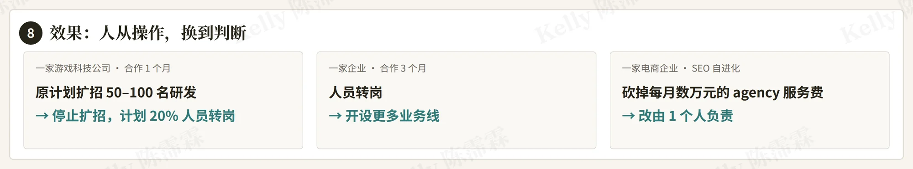

说了这么多，效果怎么样？讲三个案例，客户我都不点名。

第一家，一家游戏科技公司，合作一个月。他们原本计划扩招 50 到 100 名研发。现在停止扩招了，并且计划把 20% 的人转岗。这对应的，就是第一条：Agent 用对了，就不用再靠招人去对接系统。

第二家，合作三个月。人员转岗，开了更多的业务线。

第三家，一家电商企业，就是刚才 SEO 那个例子。先砍掉了每个月几万块的 agency 服务费，改由一个人负责。这个人每天做的，就是看 Agent 交上来的日报，做判断。

这三家，都是人从操作，换到了判断。

回到开场那个问题：为什么还在扩招？因为你把 Agent 当成了又一个给人用的系统。

## 地图第 9 块：回去就能做

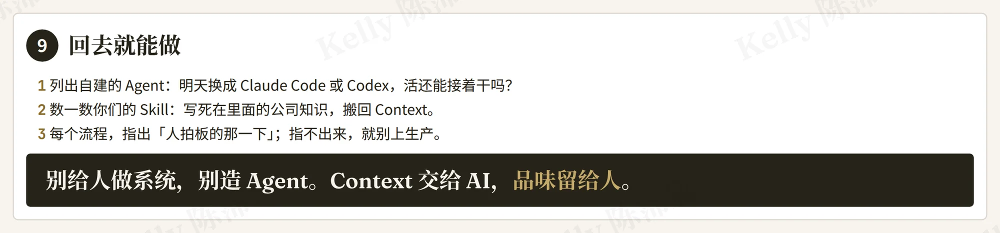

最后，送大家三个回去就能做的动作。

第一，把你们自建的 Agent 列出来，问一句：明天把它换成 Claude Code 或者 Codex，活还能接着干吗？干不了，说明公司的知识被锁在 Agent 里了。这其实是在测：你的知识，是放在 Agent 身上，还是放在公司里。

第二，数一数你们有多少个 Skill。写死在里面的公司知识，搬回 Context。再用那两条规矩筛一遍：这个 Skill 每周有人用吗？需要人品味吗？两条都不满足的，删掉，或者直接全自动。

第三，每个流程，指出“人拍板的那一下”。指不出来，就别上生产。这一下，就是人做判断的地方。指得出来，你的 AI 才有人把关；指不出来，就是在放飞。

最后，我用几句话，把今天收起来。

系统和 Agent，不是越多越好，智能密度才重要。

Agent 不带记忆，公司带。

Agent 只按权限分，不按岗位分。

Skill 越少越好，留下来的，都是公司的核心。

别全自动，在关键环节，把判断留给人。

最后一句话：

**别给人做系统，别造 Agent。Context 交给 AI，品味留给人。**

## Busabase：一段视频，一页纸

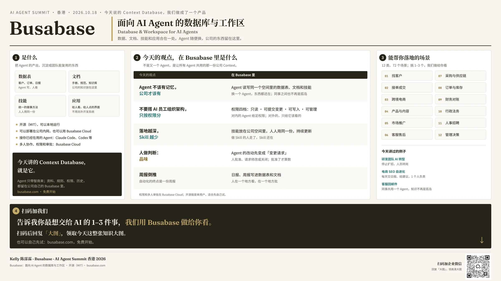

最后，说说我们自己在做的东西。

今天讲的 Context Database，我们做成了一个产品，叫 Busabase。可以先看这段 3 分钟的发布视频：[Introducing Busabase | The Base for Agents](https://www.youtube.com/watch?v=7qNWnU4hfMk)。

Busabase 是面向 AI Agent 的数据库与工作区：数据表、文档、技能、应用，合在一处。开源，MIT 协议；可以在本地跑，可以部署在公司内网，也可以用我们的 Cloud。你已经在用的 Claude Code、Codex，都可以接上来。我们做的不是又一个 Agent，而是让所有 Agent 共用的那一份公司 Context。

这是我们整理的 12 类、72 个落地场景。

今天讲的几条，在 Busabase 里都是现成的：

记忆归公司：所有 Agent 读写同一个空间。

只按权限分：权限四档，只读、可提交变更、可写入、可管理。

Skill 越少：技能放在公司空间里，人人用同一份；做 Skill 的人走了，Skill 还在。

人做判断：Agent 的改动先变成一个变更请求，人批准了才算数。

周报倒推：日报、周报写进数据表和文档，在一个地方看，在一个地方批。

## 扫码加我们

扫码加我们的企业微信，回复“大图”两个字，这整张知识大图的高清版就发给你。

也欢迎告诉我们，你最想交给 AI 的一到三件事，我们用 Busabase 做给你看。

## 几个常被问到的问题

1. **你说别造 Agent，可你们不也在做 AI 产品吗？**
   我们做的不是 Agent，是让所有 Agent 共用的那一份公司 Context。Agent 你用谁的都行。
2. **一个对内的全能 Agent，权限那么大，安全吗？**
   所以它的改动先变成提议，人批准了才算数；对外的 Agent 只给最小权限。权限是按数据分的，不是按岗位分的。
3. **Multi-Agent 不是趋势吗？**
   按权限分出几个，可以；按岗位拆，就是把诸葛亮拆成臭皮匠。
4. **Skill 越少，那社区里、课上那么多 Skill 怎么看？**
   介绍场景、学方法，用很多 Skill 没问题；落地到一家公司，入口要收敛，知识要回到公司的知识库。
5. **不能全自动，那 AI 到底省多少人？**
   看那三个案例：停止扩招、转岗、一个人顶掉一个 agency。省掉的是操作，不是判断。
6. **Agent 没有记忆，会不会每次都要从头教？**
   不会，它每次都读公司那一份 Context。教一次，所有 Agent、所有同事都受益；教在某个人电脑上，就只有他受益。
7. **Busabase 开源版和 Cloud 有什么区别？**
   开源版是单用户，适合自己先试；多人协作、权限和审批在 Cloud。
8. **MIT 那个 95%，不是被很多人质疑吗？**
   对，它的口径是“试点对利润有没有可衡量的影响”，不是“AI 没用”，也不是“95% 的项目失败”。我引用它，是因为作者给的原因：学习断层，工具不会适应公司的流程。这和我今天讲的 Context 是同一件事。
9. **METR 只有 16 个人，能说明什么？**
   样本确实小，用的也是 2025 年初的工具，METR 自己后来也说只能当历史看。我想说的只是一件事：感觉快了，不等于真的快了；个人快了，也不等于团队产出多了。
